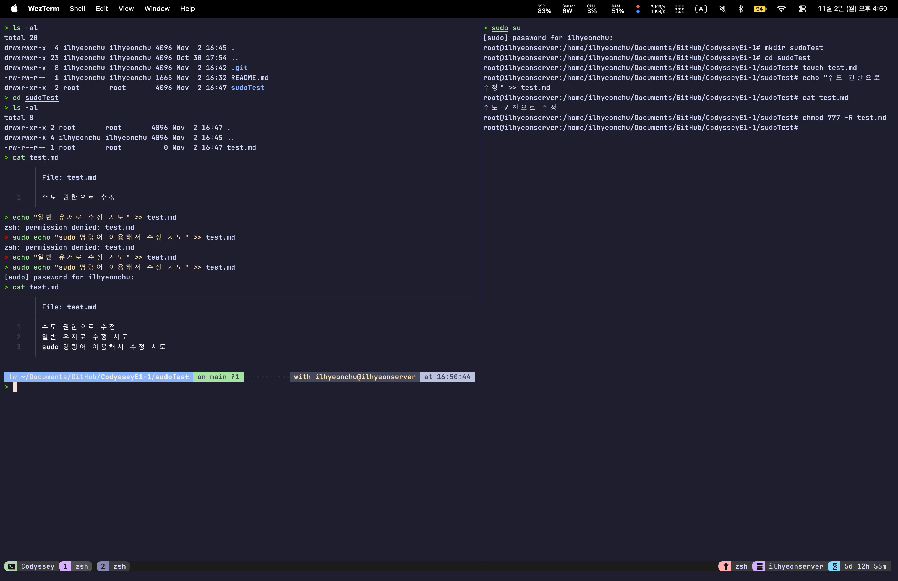
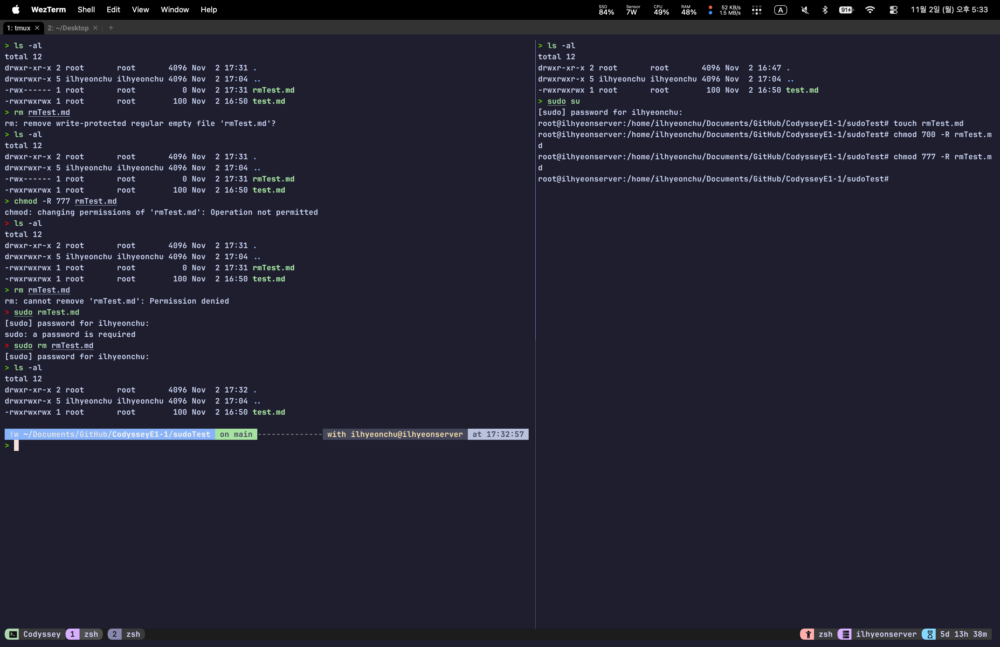
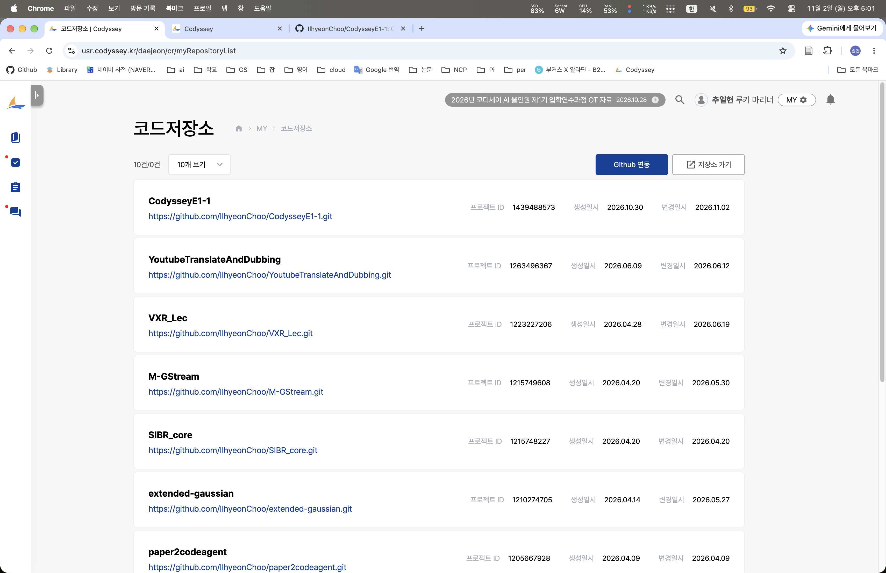

# Codyssey E1-1

## 1) 실행 환경

### 개인 서버

OS : Ubuntu 24.04.5 LTS
Shell : Zsh
Terminal : WezTerm
Docker : 29.5.3
Docker Compose : 5.1.4
Git : 2.43.0
GitHub : 2.93.0
Other : <https://github.com/IlhyeonChoo/dotfiles.git>
        <https://github.com/IlhyeonChoo/nvim.git>

Mac 또는 Windows 에서 WezTerm 을 터미널로 사용
ssh를 이용해 접속
포트 포워딩 없이 Tailscale의 Tunneling을 이용

## 2) 수행 체크리스트

- [x] 터미널 기본 조작 및 폴더 구성
- [x] 권한 변경 실습
- [x] Docker 설치 및 점검
- [x] hello-world 실행
- [x] 포트 매핑 접속 (local, tunneling)
- [x] 바운드 마운트 반영
- [x] 볼륨 영속성
- [x] Git 설정 + VSCode GitHub 연동

## 3) 수행 로그

```zsh
> docker --version
> docker --version
Docker version 29.5.3, build d1c06ef
> git --version
git version 2.43.0
> gh --version
gh version 2.93.0 (2026-05-27)
https://github.com/cli/cli/releases/tag/v2.93.0
> lsb_release -a
No LSB modules are available.
Distributor ID: Ubuntu
Description:    Ubuntu 24.04.5 LTS
Release:        24.04
Codename:       noble
> uname -a
Linux ilhyeonserver 7.0.0-38-generic #38~24.04.4-Ubuntu SMP PREEMPT_DYNAMIC Mon Sep 14 16:37:11 UTC 2 x86_64 x86_64 x86_64 GNU/Linux
> docker compose version
Docker Compose version v5.1.4
> echo $SHELL
/usr/bin/zsh
> wezterm --version
wezterm 20240203-110809-5046fc22
> tmux --version
usage: tmux [-2CDlNuVv] [-c shell-command] [-f file] [-L socket-name]
            [-S socket-path] [-T features] [command [flags]]
> tmux -V
tmux 3.4
> nvim --version
NVIM v0.11.2
Build type: Release
LuaJIT 2.1.1741730670
Run "nvim -V1 -v" for more info

```

## 4) 권한 명령어 실습

### 일반 유저

```Zsh
> ls -al
total 20
drwxrwxr-x  4 ilhyeonchu ilhyeonchu 4096 Nov  2 16:45 .
drwxrwxr-x 23 ilhyeonchu ilhyeonchu 4096 Oct 30 17:54 ..
drwxrwxr-x  8 ilhyeonchu ilhyeonchu 4096 Nov  2 16:42 .git
-rw-rw-r--  1 ilhyeonchu ilhyeonchu 1665 Nov  2 16:32 README.md
drwxr-xr-x  2 root       root       4096 Nov  2 16:47 sudoTest
> cd sudoTest
> ls -al
total 8
drwxr-xr-x 2 root       root       4096 Nov  2 16:47 .
drwxrwxr-x 4 ilhyeonchu ilhyeonchu 4096 Nov  2 16:45 ..
-rw-r--r-- 1 root       root          0 Nov  2 16:47 test.md
> cat test.md
───────┬─────────────────────────────────────────────────────────────────────────────────────────────────────────
       │ File: test.md
───────┼─────────────────────────────────────────────────────────────────────────────────────────────────────────
   1   │ 수도 권한으로 수정
───────┴─────────────────────────────────────────────────────────────────────────────────────────────────────────
> echo "일반 유저로 수정 시도" >> test.md
zsh: permission denied: test.md
> sudo echo "sudo 명령어 이용해서 수정 시도" >> test.md
zsh: permission denied: test.md
> echo "일반 유저로 수정 시도" >> test.md
> sudo echo "sudo 명령어 이용해서 수정 시도" >> test.md
[sudo] password for ilhyeonchu:
> cat test.md
───────┬─────────────────────────────────────────────────────────────────────────────────────────────────────────
       │ File: test.md
───────┼─────────────────────────────────────────────────────────────────────────────────────────────────────────
   1   │ 수도 권한으로 수정
   2   │ 일반 유저로 수정 시도
   3   │ sudo 명령어 이용해서 수정 시도


> ls -al
total 12
drwxr-xr-x 2 root       root       4096 Nov  2 17:31 .
drwxrwxr-x 5 ilhyeonchu ilhyeonchu 4096 Nov  2 17:04 ..
-rwx------ 1 root       root          0 Nov  2 17:31 rmTest.md
-rwxrwxrwx 1 root       root        100 Nov  2 16:50 test.md
> rm rmTest.md
rm: remove write-protected regular empty file 'rmTest.md'?
> ls -al
total 12
drwxr-xr-x 2 root       root       4096 Nov  2 17:31 .
drwxrwxr-x 5 ilhyeonchu ilhyeonchu 4096 Nov  2 17:04 ..
-rwx------ 1 root       root          0 Nov  2 17:31 rmTest.md
-rwxrwxrwx 1 root       root        100 Nov  2 16:50 test.md
> chmod -R 777 rmTest.md
chmod: changing permissions of 'rmTest.md': Operation not permitted
> ls -al
total 12
drwxr-xr-x 2 root       root       4096 Nov  2 17:31 .
drwxrwxr-x 5 ilhyeonchu ilhyeonchu 4096 Nov  2 17:04 ..
-rwxrwxrwx 1 root       root          0 Nov  2 17:31 rmTest.md
-rwxrwxrwx 1 root       root        100 Nov  2 16:50 test.md
> rm rmTest.md
rm: cannot remove 'rmTest.md': Permission denied
> sudo rmTest.md
[sudo] password for ilhyeonchu:
sudo: a password is required
> sudo rm rmTest.md
[sudo] password for ilhyeonchu:
> ls -al
total 12
drwxr-xr-x 2 root       root       4096 Nov  2 17:32 .
drwxrwxr-x 5 ilhyeonchu ilhyeonchu 4096 Nov  2 17:04 ..
-rwxrwxrwx 1 root       root        100 Nov  2 16:50 test.md

```

### root

```zsh
> sudo su
[sudo] password for ilhyeonchu:
root@ilhyeonserver:/home/ilhyeonchu/Documents/GitHub/CodysseyE1-1# mkdir sudoTest
root@ilhyeonserver:/home/ilhyeonchu/Documents/GitHub/CodysseyE1-1# cd sudoTest
root@ilhyeonserver:/home/ilhyeonchu/Documents/GitHub/CodysseyE1-1/sudoTest# touch test.md
root@ilhyeonserver:/home/ilhyeonchu/Documents/GitHub/CodysseyE1-1/sudoTest# echo "수도 권한으로  수정" >> test.md
root@ilhyeonserver:/home/ilhyeonchu/Documents/GitHub/CodysseyE1-1/sudoTest# cat test.md
수도 권한으로 수정
root@ilhyeonserver:/home/ilhyeonchu/Documents/GitHub/CodysseyE1-1/sudoTest# chmod 777 -R test.md
root@ilhyeonserver:/home/ilhyeonchu/Documents/GitHub/CodysseyE1-1/sudoTest#

> sudo su
[sudo] password for ilhyeonchu:
root@ilhyeonserver:/home/ilhyeonchu/Documents/GitHub/CodysseyE1-1/sudoTest# touch rmTest.md
root@ilhyeonserver:/home/ilhyeonchu/Documents/GitHub/CodysseyE1-1/sudoTest# chmod 700 -R rmTest.md
root@ilhyeonserver:/home/ilhyeonchu/Documents/GitHub/CodysseyE1-1/sudoTest# chmod 777 -R rmTest.md

```

### 이미지




## 5) Docker 기본 운영 명령 수행

## 8) Git 설정 및 연동

```zsh
> git config --list
user.name=ilhyeonchu
user.mail=ilhyeonchu@gmail.com
user.email=ilhyeonchu@gmail.com
credential.helper=store
include.path=~/dotfiles/git/.gitconfig
core.pager=sh -c 'command -v delta >/dev/null 2>&1 && exec delta "$@" || exec less -R "$@"' --
interactive.difffilter=sh -c 'command -v delta >/dev/null 2>&1 && exec delta --color-only || exec cat' --
delta.navigate=true
delta.line-numbers=true
delta.side-by-side=false
diff.colormoved=default
merge.conflictstyle=zdiff3
core.repositoryformatversion=0
core.filemode=true
core.bare=false
core.logallrefupdates=true
remote.origin.url=git@github.com:IlhyeonChoo/CodysseyE1-1.git
remote.origin.fetch=+refs/heads/*:refs/remotes/origin/*
branch.main.remote=origin
branch.main.merge=refs/heads/main

```

### 깃헙과 코디세이 토큰으로 연동 이미지


