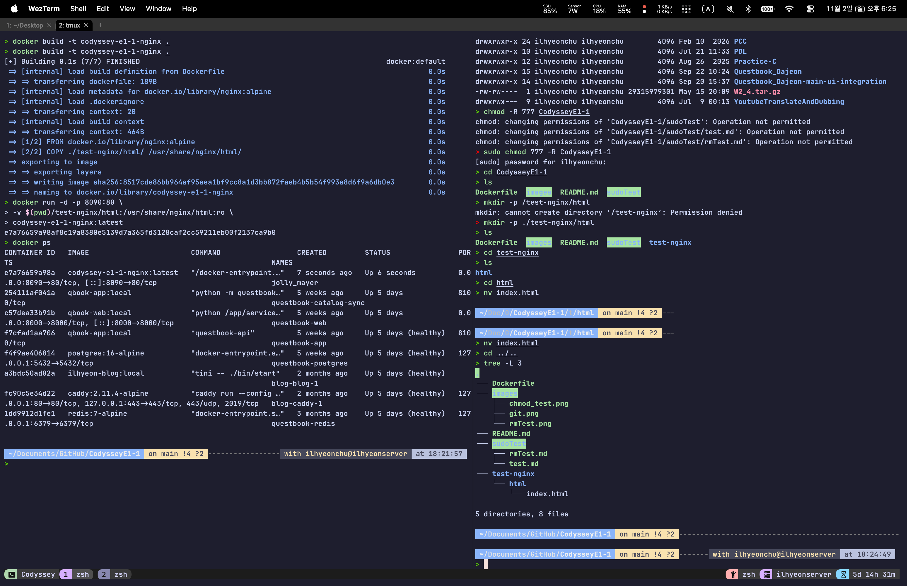
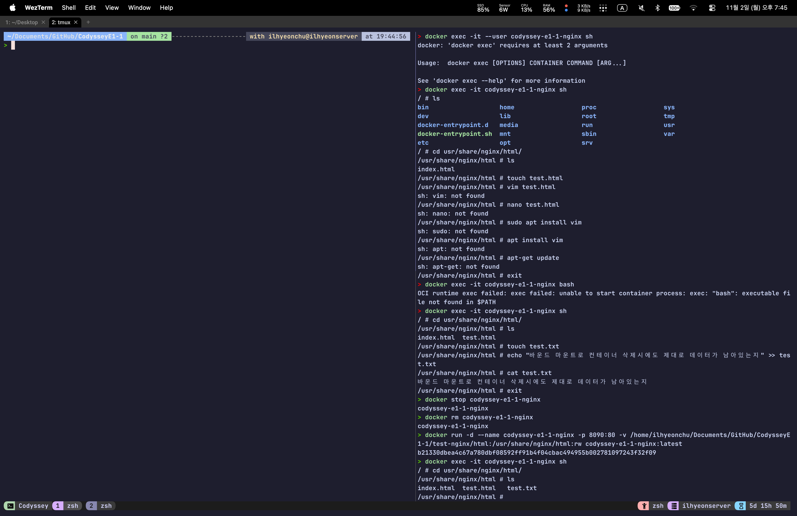
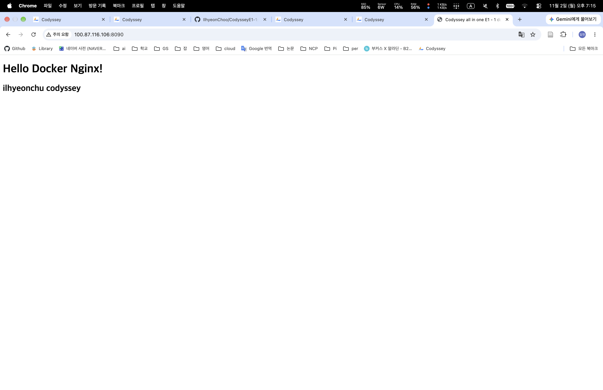
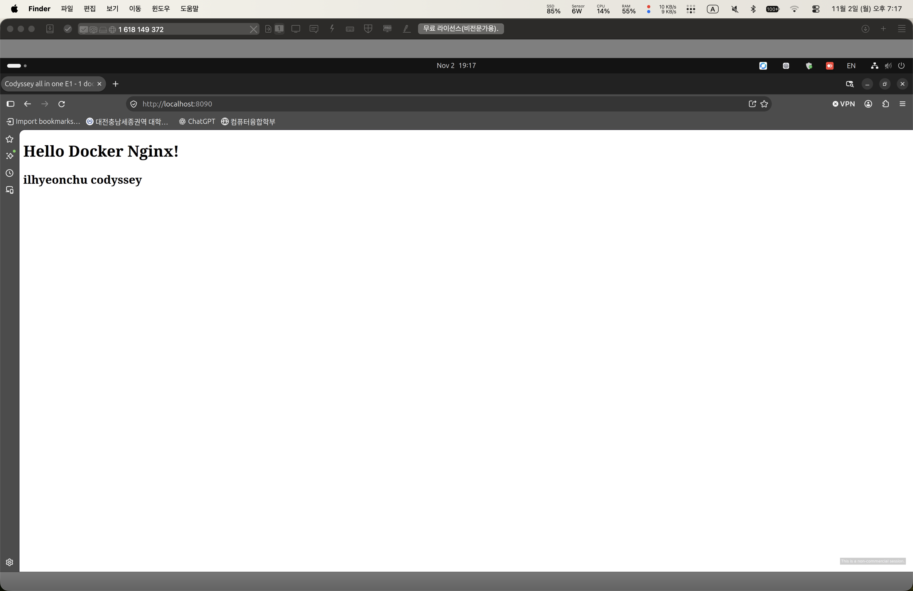

# Codyssey E1-1

## 1) 실행 환경

### 개인 서버

OS : Ubuntu 24.04.5 LTS
Shell : Zsh
Terminal : WezTerm
Docker : 29.5.3
Docker Compose : 5.1.4
Git : 2.43.0
GitHub : 2.93.0
Other : <https://github.com/IlhyeonChoo/dotfiles.git>
        <https://github.com/IlhyeonChoo/nvim.git>

Mac 또는 Windows 에서 WezTerm 을 터미널로 사용
ssh를 이용해 접속
포트 포워딩 없이 Tailscale의 Tunneling을 이용

## 2) 수행 체크리스트

- [x] 터미널 기본 조작 및 폴더 구성
- [x] 권한 변경 실습
- [x] Docker 설치 및 점검
- [x] hello-world 실행
- [x] 포트 매핑 접속 (local, tunneling)
- [x] 바운드 마운트 반영
- [x] Git 설정

## 3) 수행 로그

```zsh
> docker --version
> docker --version
Docker version 29.5.3, build d1c06ef
> git --version
git version 2.43.0
> gh --version
gh version 2.93.0 (2026-05-27)
https://github.com/cli/cli/releases/tag/v2.93.0
> lsb_release -a
No LSB modules are available.
Distributor ID: Ubuntu
Description:    Ubuntu 24.04.5 LTS
Release:        24.04
Codename:       noble
> uname -a
Linux ilhyeonserver 7.0.0-38-generic #38~24.04.4-Ubuntu SMP PREEMPT_DYNAMIC Mon Sep 14 16:37:11 UTC 2 x86_64 x86_64 x86_64 GNU/Linux
> docker compose version
Docker Compose version v5.1.4
> echo $SHELL
/usr/bin/zsh
> wezterm --version
wezterm 20240203-110809-5046fc22
> tmux --version
usage: tmux [-2CDlNuVv] [-c shell-command] [-f file] [-L socket-name]
            [-S socket-path] [-T features] [command [flags]]
> tmux -V
tmux 3.4
> nvim --version
NVIM v0.11.2
Build type: Release
LuaJIT 2.1.1741730670
Run "nvim -V1 -v" for more info

```

## 4) 권한 명령어 실습

### 일반 유저

```Zsh
> ls -al
total 20
drwxrwxr-x  4 ilhyeonchu ilhyeonchu 4096 Nov  2 16:45 .
drwxrwxr-x 23 ilhyeonchu ilhyeonchu 4096 Oct 30 17:54 ..
drwxrwxr-x  8 ilhyeonchu ilhyeonchu 4096 Nov  2 16:42 .git
-rw-rw-r--  1 ilhyeonchu ilhyeonchu 1665 Nov  2 16:32 README.md
drwxr-xr-x  2 root       root       4096 Nov  2 16:47 sudoTest
> cd sudoTest
> ls -al
total 8
drwxr-xr-x 2 root       root       4096 Nov  2 16:47 .
drwxrwxr-x 4 ilhyeonchu ilhyeonchu 4096 Nov  2 16:45 ..
-rw-r--r-- 1 root       root          0 Nov  2 16:47 test.md
> cat test.md
───────┬─────────────────────────────────────────────────────────────────────────────────────────────────────────
       │ File: test.md
───────┼─────────────────────────────────────────────────────────────────────────────────────────────────────────
   1   │ 수도 권한으로 수정
───────┴─────────────────────────────────────────────────────────────────────────────────────────────────────────
> echo "일반 유저로 수정 시도" >> test.md
zsh: permission denied: test.md
> sudo echo "sudo 명령어 이용해서 수정 시도" >> test.md
zsh: permission denied: test.md
> echo "일반 유저로 수정 시도" >> test.md
> sudo echo "sudo 명령어 이용해서 수정 시도" >> test.md
[sudo] password for ilhyeonchu:
> cat test.md
───────┬─────────────────────────────────────────────────────────────────────────────────────────────────────────
       │ File: test.md
───────┼─────────────────────────────────────────────────────────────────────────────────────────────────────────
   1   │ 수도 권한으로 수정
   2   │ 일반 유저로 수정 시도
   3   │ sudo 명령어 이용해서 수정 시도


> ls -al
total 12
drwxr-xr-x 2 root       root       4096 Nov  2 17:31 .
drwxrwxr-x 5 ilhyeonchu ilhyeonchu 4096 Nov  2 17:04 ..
-rwx------ 1 root       root          0 Nov  2 17:31 rmTest.md
-rwxrwxrwx 1 root       root        100 Nov  2 16:50 test.md
> rm rmTest.md
rm: remove write-protected regular empty file 'rmTest.md'?
> ls -al
total 12
drwxr-xr-x 2 root       root       4096 Nov  2 17:31 .
drwxrwxr-x 5 ilhyeonchu ilhyeonchu 4096 Nov  2 17:04 ..
-rwx------ 1 root       root          0 Nov  2 17:31 rmTest.md
-rwxrwxrwx 1 root       root        100 Nov  2 16:50 test.md
> chmod -R 777 rmTest.md
chmod: changing permissions of 'rmTest.md': Operation not permitted
> ls -al
total 12
drwxr-xr-x 2 root       root       4096 Nov  2 17:31 .
drwxrwxr-x 5 ilhyeonchu ilhyeonchu 4096 Nov  2 17:04 ..
-rwxrwxrwx 1 root       root          0 Nov  2 17:31 rmTest.md
-rwxrwxrwx 1 root       root        100 Nov  2 16:50 test.md
> rm rmTest.md
rm: cannot remove 'rmTest.md': Permission denied
> sudo rmTest.md
[sudo] password for ilhyeonchu:
sudo: a password is required
> sudo rm rmTest.md
[sudo] password for ilhyeonchu:
> ls -al
total 12
drwxr-xr-x 2 root       root       4096 Nov  2 17:32 .
drwxrwxr-x 5 ilhyeonchu ilhyeonchu 4096 Nov  2 17:04 ..
-rwxrwxrwx 1 root       root        100 Nov  2 16:50 test.md

```

### root

권한은 숫자로 변환시 각 숫자가 소유자/소유자의 그룹/기타 그룹의 권한을 의미한다.
처음에 700으로 권한을 설정하여 소유자만 모든 권한을 가지고 다른 유저는 아무런 권한도 없도록 설정
이후 권한을 777으로 변경하여 모든 유저가 모든 권한을 가지도록 설정
숫자의 의미는 3자리 이진수로 각 자리가 읽기/쓰기/실행 권한을 의미한다
즉 1은 실행만 2는 쓰기만 3은 실행과 쓰기 4는 읽기 5는 읽기와 실행 6은 읽기와 쓰기 7은 모든 권한을 의미한다.

```zsh
> sudo su
[sudo] password for ilhyeonchu:
root@ilhyeonserver:/home/ilhyeonchu/Documents/GitHub/CodysseyE1-1# mkdir sudoTest
root@ilhyeonserver:/home/ilhyeonchu/Documents/GitHub/CodysseyE1-1# cd sudoTest
root@ilhyeonserver:/home/ilhyeonchu/Documents/GitHub/CodysseyE1-1/sudoTest# touch test.md
root@ilhyeonserver:/home/ilhyeonchu/Documents/GitHub/CodysseyE1-1/sudoTest# echo "수도 권한으로  수정" >> test.md
root@ilhyeonserver:/home/ilhyeonchu/Documents/GitHub/CodysseyE1-1/sudoTest# cat test.md
수도 권한으로 수정
root@ilhyeonserver:/home/ilhyeonchu/Documents/GitHub/CodysseyE1-1/sudoTest# chmod 777 -R test.md
root@ilhyeonserver:/home/ilhyeonchu/Documents/GitHub/CodysseyE1-1/sudoTest#

> sudo su
[sudo] password for ilhyeonchu:
root@ilhyeonserver:/home/ilhyeonchu/Documents/GitHub/CodysseyE1-1/sudoTest# touch rmTest.md
root@ilhyeonserver:/home/ilhyeonchu/Documents/GitHub/CodysseyE1-1/sudoTest# chmod 700 -R rmTest.md
root@ilhyeonserver:/home/ilhyeonchu/Documents/GitHub/CodysseyE1-1/sudoTest# chmod 777 -R rmTest.md

root@ilhyeonserver:/home/ilhyeonchu/Documents/GitHub/CodysseyE1-1/sudoTest# ls -al
total 12
drwxr-xr-x 2 root       root       4096 Nov  2 17:32 .
drwxrwxr-x 5 ilhyeonchu ilhyeonchu 4096 Nov  2 17:36 ..
-rwxrwxrwx 1 root       root        100 Nov  2 16:50 test.md
root@ilhyeonserver:/home/ilhyeonchu/Documents/GitHub/CodysseyE1-1/sudoTest# touch rmTest.md
root@ilhyeonserver:/home/ilhyeonchu/Documents/GitHub/CodysseyE1-1/sudoTest# ls -al
total 12
drwxr-xr-x 2 root       root       4096 Nov  2 17:37 .
drwxrwxr-x 5 ilhyeonchu ilhyeonchu 4096 Nov  2 17:36 ..
-rw-r--r-- 1 root       root          0 Nov  2 17:37 rmTest.md
-rwxrwxrwx 1 root       root        100 Nov  2 16:50 test.md
root@ilhyeonserver:/home/ilhyeonchu/Documents/GitHub/CodysseyE1-1/sudoTest# chmod 700 -R rmTest.md
root@ilhyeonserver:/home/ilhyeonchu/Documents/GitHub/CodysseyE1-1/sudoTest# ls -al
total 12
drwxr-xr-x 2 root       root       4096 Nov  2 17:37 .
drwxrwxr-x 5 ilhyeonchu ilhyeonchu 4096 Nov  2 17:36 ..
-rwx------ 1 root       root          0 Nov  2 17:37 rmTest.md
-rwxrwxrwx 1 root       root        100 Nov  2 16:50 test.md
root@ilhyeonserver:/home/ilhyeonchu/Documents/GitHub/CodysseyE1-1/sudoTest# chmod 777 -R rmTest.md
root@ilhyeonserver:/home/ilhyeonchu/Documents/GitHub/CodysseyE1-1/sudoTest# ls -al
total 12
drwxr-xr-x 2 root       root       4096 Nov  2 17:37 .
drwxrwxr-x 5 ilhyeonchu ilhyeonchu 4096 Nov  2 17:36 ..
-rwxrwxrwx 1 root       root          0 Nov  2 17:37 rmTest.md
-rwxrwxrwx 1 root       root        100 Nov  2 16:50 test.md


```

### 이미지


## 5) Docker 기본 운영 명령 수행

```
> docker container run hello-world:latest

Hello from Docker!
This message shows that your installation appears to be working correctly.

To generate this message, Docker took the following steps:
 1. The Docker client contacted the Docker daemon.
 2. The Docker daemon pulled the "hello-world" image from the Docker Hub.
    (amd64)
 3. The Docker daemon created a new container from that image which runs the
    executable that produces the output you are currently reading.
 4. The Docker daemon streamed that output to the Docker client, which sent it
    to your terminal.

To try something more ambitious, you can run an Ubuntu container with:
 $ docker run -it ubuntu bash

Share images, automate workflows, and more with a free Docker ID:
 https://hub.docker.com/

For more examples and ideas, visit:
 https://docs.docker.com/get-started/

> docker info
Client: Docker Engine - Community
 Version:    29.5.3
 Context:    default
 Debug Mode: false
 Plugins:
  buildx: Docker Buildx (Docker Inc.)
    Version:  v0.34.1
    Path:     /usr/libexec/docker/cli-plugins/docker-buildx
  compose: Docker Compose (Docker Inc.)
    Version:  v5.1.4
    Path:     /usr/libexec/docker/cli-plugins/docker-compose

Server:
 Containers: 9
  Running: 7
  Paused: 0
  Stopped: 2
 Images: 70
 Server Version: 29.5.3
 Storage Driver: overlay2
  Backing Filesystem: extfs
  Supports d_type: true
  Using metacopy: false
  Native Overlay Diff: true
  userxattr: false
 Logging Driver: json-file
 Cgroup Driver: systemd
 Cgroup Version: 2
 Plugins:
  Volume: local
  Network: bridge host ipvlan macvlan null overlay
  Log: awslogs fluentd gcplogs gelf journald json-file local splunk syslog
 CDI spec directories:
  /etc/cdi
  /var/run/cdi
 Swarm: inactive
 Runtimes: io.containerd.runc.v2 runc
 Default Runtime: runc
 Init Binary: docker-init
 containerd version: 193637f7ee8ae5f5aa5248f49e7baa3e6164966e
 runc version: v1.3.5-0-g488fc13e
 init version: de40ad0
 Security Options:
  apparmor
  seccomp
   Profile: builtin
  cgroupns
 Kernel Version: 7.0.0-38-generic
 Operating System: Ubuntu 24.04.5 LTS
 OSType: linux
 Architecture: x86_64
 CPUs: 16
 Total Memory: 90.23GiB
 Name: ilhyeonserver
 ID: 3e940137-08e0-482f-9008-74884994ad0b
 Docker Root Dir: /var/lib/docker
 Debug Mode: false
 Experimental: false
 Insecure Registries:
  ::1/128
  127.0.0.0/8
 Live Restore Enabled: false
 Firewall Backend: iptables
  EnableUserlandProxy: true
  UserlandProxyPath: /usr/bin/docker-proxy

> docker ps -a
CONTAINER ID   IMAGE                 COMMAND                  CREATED              STATUS                          PORTS                                                             NAMES
0a8eac13eb63   hello-world:latest    "/hello"                 About a minute ago   Exited (0) About a minute ago                                                                     elastic_gates
3c82d2f46cc0   hello-world:latest    "/hello"                 About a minute ago   Exited (0) About a minute ago                                                                     crazy_edison
254111af041a   qbook-app:local       "python -m questbook…"   5 weeks ago          Up 5 days                       8100/tcp                                                          questbook-catalog-sync
c57dea33b91b   qbook-web:local       "python /app/service…"   5 weeks ago          Up 5 days                       0.0.0.0:8000->8000/tcp, [::]:8000->8000/tcp                       questbook-web
f7cfad1aa706   qbook-app:local       "questbook-api"          5 weeks ago          Up 5 days (healthy)             8100/tcp                                                          questbook-app
f4f9ae406814   postgres:16-alpine    "docker-entrypoint.s…"   5 weeks ago          Up 5 days (healthy)             127.0.0.1:5432->5432/tcp                                          questbook-postgres
a3bdc50ad02a   ilhyeon-blog:local    "tini -- ./bin/start"    2 months ago         Up 5 days (healthy)                                                                               blog-blog-1
fc90c5e34d22   caddy:2.11.4-alpine   "caddy run --config …"   2 months ago         Up 5 days (healthy)             127.0.0.1:80->80/tcp, 127.0.0.1:443->443/tcp, 443/udp, 2019/tcp   blog-caddy-1
1dd9912d1fe1   redis:7-alpine        "docker-entrypoint.s…"   3 months ago         Up 5 days (healthy)             127.0.0.1:6379->6379/tcp                                          questbook-redis
> docker images
                                                                                                                                                                                               i Info →   U  In Use
IMAGE                              ID             DISK USAGE   CONTENT SIZE   EXTRA
adminer:latest                     f72348ce3757        128MB             0B
caddy:2.11.4-alpine                af555904a096       62.9MB             0B    U
hello-world:latest                 e2ac70e7319a       10.1kB             0B    U
homeapps-nextcloud-smb:fpm         359ffe56ea0a        1.5GB             0B
ilhyeon-blog:image-library-final   85e87bf36cb6        449MB             0B
ilhyeon-blog:image-library-test    5850202a49a9        449MB             0B
ilhyeon-blog:local                 b33f75028616        796MB             0B    U
ilhyeon-blog:video-library-test    603a417554ef        796MB             0B
mariadb:11                         48f7ae354376        329MB             0B
nginx:alpine                       4a86014ec699       52.5MB             0B
postgres:16-alpine                 e684c11a6c7c        294MB             0B    U
python:latest                      0711502b4632       1.12GB             0B
qbook-app:local                    b2e0a890b966        169MB             0B    U
qbook-web:local                    4aaede7227c4        138MB             0B    U
redis:7-alpine                     487efc061638       39.1MB             0B    U
ruby:latest                        da38ef78b6a3       1.11GB             0B
ubuntu:noble-20260610              ef91e4b15da8       78.1MB             0B


```

## 6) Dockerfile 및 디렉토리 구조

### Dockerfile

```dockerfile
FROM nginx:alpine
LABEL org.opencontainers.image.title="codyssey-e1-1-nginx"
ENV APP_ENV=dev
EXPOSE 80
COPY ./test-nginx/html/ /usr/share/nginx/html/
```

### 디렉토리 구조

```zsh
> tree -L 3
.
├── Dockerfile
├── images
│   ├── chmod_test.png
│   ├── git.png
│   └── rmTest.png
├── README.md
├── sudoTest
│   ├── rmTest.md
│   └── test.md
└── test-nginx
    └── html
        └── index.html

5 directories, 8 files
```

### 이미지



## 7) nginx에서 사용할 기본 index.html

```html
<!DOCTYPE html>
<html lang="en">
  <head>
    <meta charset="UTF-8">
    <meta name="viewport" content="width=device-width, initial-scale=1">
    <title>Codyssey all in one E1 - 1 docker and nginx</title>
    <link href="css/style.css" rel="stylesheet">
    <body><h1>Hello Docker Nginx!</h1></body>
    <body><h2>ilhyeonchu codyssey</h2></body>
  </head>
  <body>
  
  </body>
</html>
```

## 8) Docker Build 및 실행

### 마운트 시 경로에 관하여

마운트를 실행하는 호스트의 경로는 상대 경로와 절대 경로 모두 사용 가능
환경의 변화에 대응하기 위해 $(pwd)로 현재 위치한 경로를 앞에 넣은 후 뒤쪽 경로를 이어붙여 상대 경로처럼 입력하면서 절대경로로 실행 가능하도록 구성
이후 컨테이너 내부의 경로는 호스트에서 상대 경로를 알 수 없으므로 절대 경로를 이용
포트의 경우 8080 포트를 사용중인것은 아니나 테스트시에 자주 사용하는 포트이므로 8090으로 변경하여 실행
포트 충돌시 ps 와 grep 등을 이용하여 해당 포트를 어떤 프로세서가 사용중인지 확인 후 해당 프로세서를 종료하거나 다른 포트를 이용

```zsh
> docker build -t codyssey-e1-1-nginx .
[+] Building 0.1s (7/7) FINISHED                                                          docker:default
 => [internal] load build definition from Dockerfile                                                0.0s
 => => transferring dockerfile: 189B                                                                0.0s
 => [internal] load metadata for docker.io/library/nginx:alpine                                     0.0s
 => [internal] load .dockerignore                                                                   0.0s
 => => transferring context: 2B                                                                     0.0s
 => [internal] load build context                                                                   0.0s
 => => transferring context: 464B                                                                   0.0s
 => [1/2] FROM docker.io/library/nginx:alpine                                                       0.0s
 => [2/2] COPY ./test-nginx/html/ /usr/share/nginx/html/                                            0.0s
 => exporting to image                                                                              0.0s
 => => exporting layers                                                                             0.0s
 => => writing image sha256:8517cde86bb964af95aea1bf9cc8a1d3bb872faeb4b5b54f993a8d6f9a6db0e3        0.0s
 => => naming to docker.io/library/codyssey-e1-1-nginx                                              0.0s
> docker run -d -p 8090:80 \
> -v $(pwd)/test-nginx/html:/usr/share/nginx/html:ro \
> codyssey-e1-1-nginx:latest
e7a76659a98af8c19a8380e5139d7a365fd3128caf2cc59211eb00f2137ca9b0
> docker ps
CONTAINER ID   IMAGE                        COMMAND                  CREATED         STATUS                PORTS                                                             NAMES
e7a76659a98a   codyssey-e1-1-nginx:latest   "/docker-entrypoint.…"   7 seconds ago   Up 6 seconds          0.0.0.0:8090->80/tcp, [::]:8090->80/tcp                           jolly_mayer
254111af041a   qbook-app:local              "python -m questbook…"   5 weeks ago     Up 5 days             8100/tcp                                                          questbook-catalog-sync
c57dea33b91b   qbook-web:local              "python /app/service…"   5 weeks ago     Up 5 days             0.0.0.0:8000->8000/tcp, [::]:8000->8000/tcp                       questbook-web
f7cfad1aa706   qbook-app:local              "questbook-api"          5 weeks ago     Up 5 days (healthy)   8100/tcp                                                          questbook-app
f4f9ae406814   postgres:16-alpine           "docker-entrypoint.s…"   5 weeks ago     Up 5 days (healthy)   127.0.0.1:5432->5432/tcp                                          questbook-postgres
a3bdc50ad02a   ilhyeon-blog:local           "tini -- ./bin/start"    2 months ago    Up 5 days (healthy)                                                                     blog-blog-1
fc90c5e34d22   caddy:2.11.4-alpine          "caddy run --config …"   2 months ago    Up 5 days (healthy)   127.0.0.1:80->80/tcp, 127.0.0.1:443->443/tcp, 443/udp, 2019/tcp   blog-caddy-1
1dd9912d1fe1   redis:7-alpine               "docker-entrypoint.s…"   3 months ago    Up 5 days (healthy)   127.0.0.1:6379->6379/tcp
```

### 권한 문제 발생 및 해결

위의 명령어로 실행 시 마운트 디렉토리 권한 문제로 ./test-nginx/html 내부의 파일 수정 불가
아래의 명령어로 교체 후 해결

```zsh
> docker run -d --name codyssey-e1-1-nginx -p 8090:80 -v /home/ilhyeonchu/Documents/GitHub/CodysseyE1-1/test-nginx/html:/usr/share/nginx/html:rw codyssey-e1-1-nginx:latest
6ab971c2704ac5329c9baf7c3a55926f5aae54b315e50c44043326650a3ade0b
```

### 테스트 파일 생성 후 컨테이너 재생성

```sh
> docker exec -it codyssey-e1-1-nginx sh
/ # ls
bin                   home                  proc                  sys
dev                   lib                   root                  tmp
docker-entrypoint.d   media                 run                   usr
docker-entrypoint.sh  mnt                   sbin                  var
etc                   opt                   srv
/ # cd usr/share/nginx/html/
/usr/share/nginx/html # ls
index.html
/usr/share/nginx/html # touch test.html
/usr/share/nginx/html # vim test.html
sh: vim: not found
/usr/share/nginx/html # nano test.html
sh: nano: not found
/usr/share/nginx/html # sudo apt install vim
sh: sudo: not found
/usr/share/nginx/html # apt install vim
sh: apt: not found
/usr/share/nginx/html # apt-get update
sh: apt-get: not found
/usr/share/nginx/html # exit
> docker exec -it codyssey-e1-1-nginx bash
OCI runtime exec failed: exec failed: unable to start container process: exec: "bash": executable file not found in $PATH
> docker exec -it codyssey-e1-1-nginx sh
/ # cd usr/share/nginx/html/
/usr/share/nginx/html # ls
index.html  test.html
/usr/share/nginx/html # touch test.txt
/usr/share/nginx/html # echo "바운드 마운트로 컨테이너 삭제시에도 제대로 데이터가 남아있는지" >> tes
t.txt
/usr/share/nginx/html # cat test.txt
바운드 마운트로 컨테이너 삭제시에도 제대로 데이터가 남아있는지
/usr/share/nginx/html # exit
> docker stop codyssey-e1-1-nginx
codyssey-e1-1-nginx
> docker rm codyssey-e1-1-nginx
codyssey-e1-1-nginx
> docker run -d --name codyssey-e1-1-nginx -p 8090:80 -v /home/ilhyeonchu/Documents/GitHub/CodysseyE1-1/test-nginx/html:/usr/share/nginx/html:rw codyssey-e1-1-nginx:latest
b21330dbea4c67a780dbf08592ff91b4f04cbac494955b002781097243f32f09
> docker exec -it codyssey-e1-1-nginx sh
/ # cd usr/share/nginx/html/
/usr/share/nginx/html # ls
index.html  test.html   test.txt
/usr/share/nginx/html #
```

#### 이미지



## 9) 브라우저 접속

### 1. 원격에서 tailscale을 이용한 접속



### 2. 로컬에서 접속



## 10) Git 설정 및 연동

```zsh
> git config --list
user.name=ilhyeonchu
user.mail=ilhyeonchu@gmail.com
user.email=ilhyeonchu@gmail.com
credential.helper=store
include.path=~/dotfiles/git/.gitconfig
core.pager=sh -c 'command -v delta >/dev/null 2>&1 && exec delta "$@" || exec less -R "$@"' --
interactive.difffilter=sh -c 'command -v delta >/dev/null 2>&1 && exec delta --color-only || exec cat' --
delta.navigate=true
delta.line-numbers=true
delta.side-by-side=false
diff.colormoved=default
merge.conflictstyle=zdiff3
core.repositoryformatversion=0
core.filemode=true
core.bare=false
core.logallrefupdates=true
remote.origin.url=git@github.com:IlhyeonChoo/CodysseyE1-1.git
remote.origin.fetch=+refs/heads/*:refs/remotes/origin/*
branch.main.remote=origin
branch.main.merge=refs/heads/main

> git log
commit a14dfba57c8762685343b9cfe4ee18317984d4a3 (HEAD -> main, origin/main)
Author: ilhyeonchu <ilhyeonchu@gmail.com>
Date:   Mon Nov 2 17:38:35 2026 +0900

    chmod 후 변경된 권한 출력 명령어 추가

commit a973b7f0e39faedc21c970bc33f386771026e8c1
Author: ilhyeonchu <ilhyeonchu@gmail.com>
Date:   Mon Nov 2 17:36:09 2026 +0900

    rmTest image 추가

commit 67a476e699e13ae95f264640dc4190106efc4e17
Author: ilhyeonchu <ilhyeonchu@gmail.com>
Date:   Mon Nov 2 17:35:08 2026 +0900

    rm 추가

commit aad0891baac2b09fe2d86082111d40fc07d3c06b
Author: ilhyeonchu <ilhyeonchu@gmail.com>
Date:   Mon Nov 2 17:04:29 2026 +0900

    git 연동 이미지 추가


```

### 깃헙과 코디세이 토큰으로 연동 이미지


